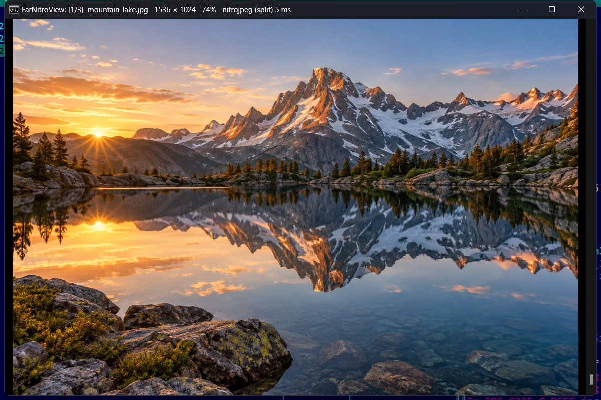
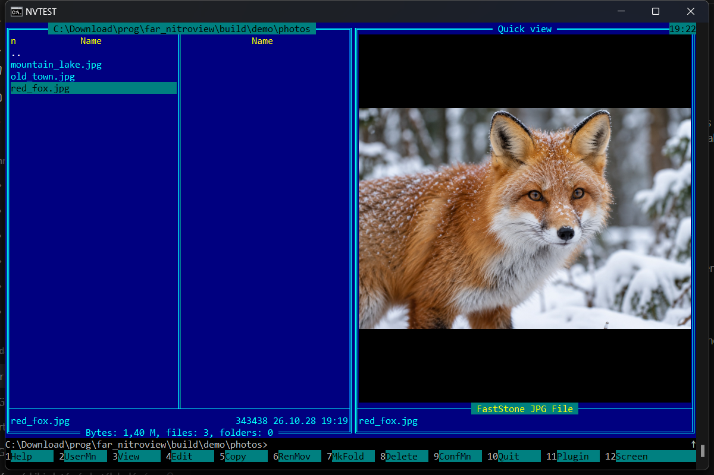

<h1 align="center">FarNitroView</h1>

<p align="center">
  <b>A very fast image viewer plugin for Far Manager 3 (x64)</b><br>
  PictureView's look and feel, powered by the parallel decoders of <a href="https://github.com/gereoffy/jpeg-nitro">jpeg-nitro</a>
</p>

<p align="center">
  <a href="https://github.com/danzig666/farnitroview/actions/workflows/build.yml"></a>
  <a href="https://github.com/danzig666/farnitroview/releases/latest"></a>
  
  <a href="LICENSE"></a>
</p>

<p align="center"></p>

Press **Enter** or **F3** on a picture and it is on screen before you let go of the key: a 24-megapixel
JPEG decodes in a few tens of milliseconds on all your cores, and the next and previous images are
already decoded in the background while you look. It works the way the much-missed
PictureView did — same keys, same panel
navigation and selection, quick view — and runs on current Far 3 builds, in the classic console as
well as in Windows Terminal.

## Features

- **Fast**: jpeg-nitro's speculative parallel Huffman decoding (bit-exact with libjpeg-turbo),
  parallel PNG inflate, AVX2 IDCT; neighbours are prefetched, so paging is instant.
- **Opens the way you are used to**: Enter / Ctrl-PgDn, F3 (also inside archives and from Find file),
  the quick view panel (Ctrl-Q), the plugins menu (F11) in panels, viewer and editor, or `nv:file.jpg`
  on the command line.
- **Panel-aware**: pages through the active panel's images in panel order, Ins/Del/Shift change the
  selection, and on exit the cursor sits on the last picture you looked at.
- **Good-looking scaling**: area-averaged reduction (no moiré on fine detail), bilinear or
  pixel-exact enlarging, EXIF orientation, rotation and mirroring.
- **Quick view**: pictures appear in Far's quick view panel as you move the cursor, and get out of
  the way of dialogs and menus.
- **Everywhere**: drawn in a window laid over the console — conhost, Windows Terminal (found
  precisely through UI Automation), ConEmu and others; per-monitor DPI aware; full screen with F.
- **Self-contained**: one statically linked DLL, nothing to install besides it.

<p align="center"></p>

## Formats

| format | decoder |
|---|---|
| JPEG — baseline, progressive, any subsampling, grayscale | **nitrojpeg**, multi-threaded |
| PNG — non-interlaced, 1–16 bit, palette, transparency | **nitropng** |
| PSD / PSB (merged image) | **nitropsd** |
| HEIC | **nitroheic** / nitrohevc (no deblocking yet) |
| DNG raw | **nitrodng** |
| Canon CR2, Nikon NEF / NRW, Sony ARW, Fujifilm RAF | their full-size embedded JPEG, via nitrojpeg |
| WebP (lossy) | **nitrowebp** (no loop filter yet) |
| TIFF — none, PackBits, LZW, Deflate, CCITT G3/G4 | **nitrotiff** |
| GIF, BMP, ICO, JPEG XR, DDS, lossless WebP, CMYK JPEG, interlaced PNG, AVIF / JPEG XL / HEIF with the Store codecs | Windows Imaging Component |

Every jpeg-nitro path is checked in CI against Pillow/libjpeg, pixel for pixel, including EXIF
rotation (`test/`).

## Install

1. Download the [latest release](https://github.com/danzig666/farnitroview/releases/latest):
   - `FarNitroView-x.y.z-x64.zip` — for CPUs with AVX2 (Intel Haswell 2013+, AMD Zen 2017+), fastest;
   - `FarNitroView-x.y.z-x64-noavx2.zip` — for any x64 CPU.
2. Unpack it into `Far Manager\Plugins\` (you get `Plugins\FarNitroView\`).
3. Restart Far.

Requires Far Manager **3.0 build 6699** or newer, 64-bit, on Windows 10 / 11.

> If the old PictureView is still installed, switch off its *Enter archive*, *QuickView* and *View*
> processing (or remove it) — otherwise both plugins grab the same keys.

## Keys

The key map follows PictureView's last build (2018.12.11).

| key | action |
|---|---|
| <kbd>Esc</kbd> <kbd>F10</kbd> <kbd>Enter</kbd> <kbd>Alt-F4</kbd>, right click | leave (<kbd>F3</kbd> too when it opened instead of Far's viewer) |
| <kbd>Space</kbd>/<kbd>BS</kbd>, <kbd>PgDn</kbd>/<kbd>PgUp</kbd>, <kbd>N</kbd>/<kbd>B</kbd>, <kbd>2</kbd>/<kbd>1</kbd>, wheel | next / previous image — with <kbd>Shift</kbd> inverts the selection first, with <kbd>Ctrl</kbd> keeps zoom and position |
| <kbd>Home</kbd>/<kbd>End</kbd>, <kbd>R</kbd>/<kbd>T</kbd> | first / last image |
| <kbd>~</kbd> | back to the previous image (and forth again) |
| <kbd>F</kbd>, <kbd>Num 5</kbd>, <kbd>Alt-Enter</kbd>, middle click | full screen on / off |
| <kbd>*</kbd>, <kbd>9</kbd> | 100% |
| <kbd>/</kbd>, <kbd>0</kbd>, <kbd>Tab</kbd>, double click on the image | fit ↔ 100% |
| the same with <kbd>Ctrl</kbd> / <kbd>Shift</kbd> / <kbd>Alt</kbd> | fit to screen / to width / to height |
| double click on the background | fit to width or height, whichever fills the screen |
| <kbd>+</kbd>/<kbd>−</kbd>, <kbd>E</kbd>/<kbd>Q</kbd>, wheel with the left button or <kbd>Ctrl</kbd> held | zoom in √2 steps, stopping at 100% and at fit (<kbd>Alt</kbd>: fine, <kbd>Ctrl-Alt</kbd>: finer); the wheel zooms around the pointer |
| arrows, <kbd>W</kbd><kbd>A</kbd><kbd>S</kbd><kbd>D</kbd>, drag | pan (<kbd>Alt</kbd>: small steps, <kbd>Ctrl</kbd>: slow) |
| <kbd>Ins</kbd> / <kbd>Del</kbd> | select / unselect the file |
| <kbd>Ctrl-Ins</kbd> | copy the title (file, size, zoom, decoder) to the clipboard |
| <kbd>F3</kbd>/<kbd>F4</kbd>, <kbd>[</kbd>/<kbd>]</kbd> | rotate 90° left / right (<kbd>Shift</kbd> reverses) |
| <kbd>F9</kbd> / <kbd>F11</kbd> | mirror left–right / upside down |
| <kbd>F12</kbd> | undo rotations and mirrors |
| <kbd>F5</kbd> | reload |
| <kbd>I</kbd> | information line on / off |
| <kbd>F1</kbd> / <kbd>F2</kbd> | help / settings |

## Settings

<kbd>F2</kbd> in the viewer, or F9 → Options → Plugins configuration → FarNitroView:

- which actions open pictures: **Enter archive** (Enter, Ctrl-PgDn), **Quick view**, **View** (F3)
- **full screen on startup**, **smooth scaling**, **information line**
- **autosize on open** (fit large images), **enlarge small images**
- **keep position on jumps**, **loop jumping**
- **background colours** (hex `RRGGBB`) for normal and for selected files
- the **command line prefix** (default `nv`)

## Differences from PictureView

Not there (yet): paging through multi-page images and animations (Alt-PgDn, P), post-processing
(F6–F8), PVD decoder plugins, the title template. SVG, CorelDRAW and jpeg-nitro's own AVIF decoder
are not built in (they need lunasvg / libcdr / dav1d); AVIF still opens through WIC when Windows has
the AV1 extension. Quick view is placed exactly in conhost and Windows Terminal; in other terminals
the position is estimated from the window size.

## Building from source

You need [llvm-mingw](https://github.com/mstorsjo/llvm-mingw) — the jpeg-nitro decoders are
written with clang blocks (`-fblocks`), so MSVC can't build them — and a POSIX shell (Git Bash works).

```bash
git clone --recursive https://github.com/danzig666/farnitroview
cd farnitroview
# llvm-mingw, unpacked into ext/ (or set LLVM_MINGW=..., or have it on PATH)
curl -LO https://github.com/mstorsjo/llvm-mingw/releases/download/20261020/llvm-mingw-20261020-ucrt-x86_64.zip
mkdir -p ext && unzip -q llvm-mingw-20261020-ucrt-x86_64.zip -d ext
./build.sh                       # -> dist/FarNitroView/
ARCH=x86-64-v2 ./build.sh        # for CPUs without AVX2
```

Tests (need Python with Pillow): `./test/run_tests.sh` makes test images, decodes them as the plugin
does and compares with Pillow. `test/fartest.ps1` drives a real Far instance (only this plugin, a
scratch profile) with keys and mouse and takes screenshots — conhost or, with `-Wt`, Windows Terminal.

Releases are built by GitHub Actions: pushing a tag `vX.Y.Z` builds both variants, runs the tests
and publishes the zips.

## How it works

| file | |
|---|---|
| [`src/plugin.cpp`](src/plugin.cpp) | Far entry points: Analyse/Open, F3 interception (console input hook, viewer events), synchro |
| [`src/viewer.cpp`](src/viewer.cpp) | the modal viewer on Far's console input: keys, mouse, panel navigation and selection, the prefetching loader, quick view |
| [`src/overlay.cpp`](src/overlay.cpp) | the never-activated topmost window over the console, on its own thread; finds the text area in Windows Terminal via UI Automation |
| [`src/render.cpp`](src/render.cpp) | zoom and orientation: an area-averaged reduction cache, bilinear / pixel-exact enlarging, all multi-threaded |
| [`src/decode.cpp`](src/decode.cpp) | jpeg-nitro → BGRA, WIC as the fallback, transparency over the background |
| [`src/config.cpp`](src/config.cpp) | settings and the dialog |

## Credits

- [jpeg-nitro](https://github.com/gereoffy/jpeg-nitro) by A'rpi — the decoders (MIT), included as a submodule.
- [Far Manager](https://github.com/FarGroup/FarManager) plugin SDK headers (`third_party/farsdk`, BSD-3 with plugin exception).
- PictureView by Pavel Skakov — the plugin this one is modelled on.

## License

[MIT](LICENSE)
